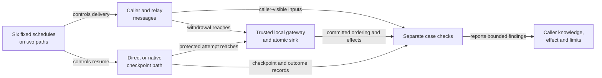

# Revocation in delegated workflows


When a caller asks to withdraw authority, what distinguishes receipt of the request, an installed revocation fence and confirmation visible to the caller? This private Node & Norm study tests that distinction in bounded local workflows. [Question and executed study](docs/decisions/2026-11-03-request-to-fence-interface-study.md).

[Research reader: understand in 90 seconds](#research-in-90-seconds) · [Reviewer: inspect evidence and limits](#evidence-and-known-limits) · [Engineer: reproduce the fixed study](#reproduce-the-request-to-fence-study)

## Saved case-report candidate · 18 November 2026

The [specification notebook](notebooks/spec_01_case_report_contract.ipynb) now links the preserved implementation, actual AI-assisted assignment/review records and the separately approved 14 November run: 19 check methods passed once. See the [preservation guide](experiments/case-report-v0.2/PRESERVATION.md) for exact source identities, labeled locator redactions and remaining gaps. This update preserves existing work; it did not rerun tests or merge. Earlier preparation-stage “not executed” wording remains historical. Further tests and merging require separate approval.

## Start here

**[Practitioner guide: Did the withdrawal actually stop the action?](notebooks/learning_03_revocation_practitioner_guide.ipynb)** starts with two saved cases that gave the requester the same status but ended differently. It includes a worksheet for reconstructing an outcome and a proposed, separate review-assistance evaluation. This guide reads saved evidence only.

**[Research-book contents and reading routes](notebooks/00_start_here.ipynb)** connect the report and four focused chapters with previous/contents/next navigation. Notebook 04 includes every preserved scripted invocation in saved static output.

**[Open the guided study report → RESEARCH_STUDY.ipynb](RESEARCH_STUDY.ipynb)**. Read the question, method, saved-case findings, limitations, roadmap and completion gates in one notebook. The report reads existing evidence; it does not rerun experiments.

Read the [dated current-study synthesis](docs/reports/2026-11-06-current-study-synthesis.md) or open [00 · Start here](notebooks/00_start_here.ipynb) for the short route through current results, open gates and the next reading steps. These are presentation updates, not new experiments.

## Traceability and AI disclosure

Open [02 · Who decided what, and what was actually checked?](notebooks/02_traceability_and_disclosure.ipynb) to explore all six sheets of the preserved v0.11 workbook, with exact cell locators and a clear historical-version boundary. GitHub shows saved static output; change selectors and rerun cells in Jupyter for exploration.

## Methods and reproduction

Open [03 · How was the study run?](notebooks/03_methods_and_reproduction.ipynb) for the protocol/version boundary, verified source freeze, actual recorded invocation, case-artifact inventory, preserved corrections and reproduction prerequisites. It reads saved evidence without running the study.

## Exact experimental inputs, outputs and code

Open [04 · Exact recorded inputs and outputs](notebooks/04_exact_scripted_inputs_outputs.ipynb) for the v0.3 pilot’s preserved scripted-model messages and an archive/source-code evidence trail across early stages. These are synthetic scripted responses, not live LLM generations or every research conversation.

## Evidence workbench

Open [01 · When is withdrawal actually established?](notebooks/01_revocation_evidence_workbench.ipynb) for a visual, executable review of the twelve saved cases. It verifies pinned inputs, separates caller knowledge from sink evidence, exposes exact source records and generates a bounded decision brief. The [run guide](notebooks/README.md) explains the offline controls and verification limits. This is a private review workbench, not a live agent runtime or a new experiment.

## At a glance

| Record | Current account |
| --- | --- |
| Question | Q1: authority withdrawal and protected effects. Evidence veracity (Q2) and oversight scaling (Q3) remain deferred. [Design](docs/specification/Testing_Revocation_in_Delegated_Workflows_v0.1.docx). |
| Completed evidence | Twelve fixed deterministic request-to-fence cases, across direct and native framework checkpoint/resume paths. [Measured summary](docs/review/WITHDRAWAL_INTERFACE_SUMMARY_v0.1.json). |
| Review | Post-run artifact checking, same-host reproduction and a separately authored protocol-first artifact audit, all AI-assisted. [Post-run review](docs/review/WITHDRAWAL_INTERFACE_POSTRUN_REVIEW_v0.1.md), [reproduction](docs/review/WITHDRAWAL_INTERFACE_LOCAL_REPRODUCTION_v0.1.md), [artifact audit](docs/review/WITHDRAWAL_INTERFACE_PROTOCOL_FIRST_AUDIT_v0.1.md). |
| Next comparison | Temporal qualification remains partial/blocked. No native Workflow/Activity test or measured Temporal experiment ran. [Status](docs/decisions/2026-11-04-temporal-partial-qualification.md). |
| Traceability | The current recorded snapshot is workbook v0.11; historical versions retain their identities. [Workbook](docs/traceability/Revocation_AI_Use_and_Research_Decision_Traceability_v0.11.xlsx). |
| Release | Private research record. Public release is not authorized; no open-source license grant for original study materials is made. [Release limits](#limits-disclosure-and-release-status). |

## Research in 90 seconds

A withdrawal request can be accepted before authority changes. An installed fence can prevent a protected effect before the caller receives confirmation. The study keeps these facts separate: request acceptance is volatile receipt; fence installation is a committed authority change at the trusted local sink; caller confirmation requires a matching completion envelope. A protected effect is an inert operation committed to that sink. [Executed study and evidence boundary](docs/decisions/2026-11-03-request-to-fence-interface-study.md), [post-run review](docs/review/WITHDRAWAL_INTERFACE_POSTRUN_REVIEW_v0.1.md).

The completed collection contains six schedules on each of two paths: direct reference and native framework checkpoint/resume. All twelve cases matched the frozen checker expectations. Six effects and six revoked denials were expected; no recorded old-authority effect followed a local fence in these fixed cases. The two paths share the authority mechanism, so they are matched conformance controls, not independent security implementations. [Summary](docs/review/WITHDRAWAL_INTERFACE_SUMMARY_v0.1.json), [reproduction and limits](docs/review/WITHDRAWAL_INTERFACE_LOCAL_REPRODUCTION_v0.1.md).

The key distinction is visible in S4 and S5. In both, a pending caller reaches observation end without valid completion and becomes unconfirmed. S4 has an installed fence and a revoked denial; S5 has no fence in the window and an authorized effect. Caller uncertainty therefore does not establish sink state. S2 also retains its pre-fence effect after confirmation: withdrawal is not rollback. [Case outcomes](docs/review/WITHDRAWAL_INTERFACE_POSTRUN_REVIEW_v0.1.md).

This is a bounded execution-grounded conformance result, not a reliability estimate, new general control principle or production-readiness claim. [Interpretation limits](docs/review/WITHDRAWAL_INTERFACE_POSTRUN_REVIEW_v0.1.md).

## Method in brief



The text sequence is: select a fixed schedule and execution path; control request delivery and worker resume; record caller-visible messages separately from committed sink evidence; check caller transitions, sink outcomes, framework propagation and completeness; report the case with its observation window and assumptions. The caller cannot read the privileged sink evidence used by the checker. [Study record](docs/decisions/2026-11-03-request-to-fence-interface-study.md), [post-run artifact review](docs/review/WITHDRAWAL_INTERFACE_POSTRUN_REVIEW_v0.1.md).

## Evidence and known limits

| Material | What is available | What it does not establish |
| --- | --- | --- |
| Request-to-fence collection | Twelve deterministic cases; six expected effects, six revoked denials; no post-fence effects in the tested schedules. [Summary](docs/review/WITHDRAWAL_INTERFACE_SUMMARY_v0.1.json). | Random sampling, failure probability, production latency, hostile-worker confinement or distributed closure. |
| Local reproduction | Fresh virtual environment; the same frozen instrument reproduced the fixed matrix on the same host/runtime. [Report](docs/review/WITHDRAWAL_INTERFACE_LOCAL_REPRODUCTION_v0.1.md). | An independent reimplementation or a larger original campaign. The external wheelhouse is not included in the study ZIP. |
| Artifact review | Post-run checking and separately authored AI-assisted artifact audit. [Post-run](docs/review/WITHDRAWAL_INTERFACE_POSTRUN_REVIEW_v0.1.md), [protocol-first](docs/review/WITHDRAWAL_INTERFACE_PROTOCOL_FIRST_AUDIT_v0.1.md). | Independent human validation or measured benefit to human reviewers. |
| Temporal development | Bounded runtime setup checks and four schema-only tests; the bridge attempt failed before dispatch with a socket-permission error, followed by a cleanup error. [Partial qualification](docs/decisions/2026-11-04-temporal-partial-qualification.md). | A bridge-control pass, native Workflow/Activity qualification or a measured Temporal result. Proposed six-cell expectations remain prospective. |
| Artifact-only checker prototype | Saved-file Python checker; 115 project tests and 26 separately authored regressions pass. [Package and replay](docs/checker-implementation/2026-11-05/README.md). | Native qualification, a production exporter, independent runtime phase sealing, calibrated deadlines or measured comparative benefit. Synthetic checks are not experimental observations. |
| Temporal methods review | Source review identifies unresolved qualification, lifecycle-mapping and observation-cut issues. [Review](docs/review/TEMPORAL_METHODS_REVIEW_20261104.md). | Executed controls, repaired runtime behavior or evidence that cancellation means no effect. |

## AI assistance and human review

AI assisted research framing, source analysis, code, tests, artifact review and documentation. A separately authored or executed model-assisted check is not independent human validation. Researcher authorization, recorded human decisions and verification are distinct; the traceability record does not claim exhaustive human review. [Research decisions and AI Disclosure Guidance](docs/traceability/Revocation_AI_Use_and_Research_Decision_Traceability_v0.11.xlsx), [release and disclosure limits](#limits-disclosure-and-release-status).

## Shared research records

The [stage-one glossary and evidence registry](docs/research-records/v0.1/README.md) separate definitions, claims, evidence status and limits. The [Temporal reconciliation](docs/research-records/v0.1/sources/reconciliation.md) records remaining acceptance gaps. Stable study identifiers and a graph evaluation remain proposed later stages.

The [proposed independent checker design](docs/decisions/2026-11-04-proposed-independent-checker.md) preserves the original specifications, erratum, consolidated account and AI-assisted reviews. That preserved design step was documentation-only. The subsequent [artifact-only checker prototype](docs/checker-implementation/2026-11-05/README.md) now adds the reviewed offline implementation and synthetic test evidence. Native qualification remains blocked, and no measured Temporal experiment is reported.

## Earlier stages and detailed research record

The following stage accounts, navigation and reproduction instructions are retained from the verified repository baseline. Their original result counts and qualifications remain separate; they are not pooled into the twelve-case study.

## Current integration pilot

The researcher authorized a bounded synthetic integration-conformance pilot on November 3 UTC (November 2 local evening), resolving the earlier pending choice.  The pilot adapts the official LangChain personal-assistant email branch through actual supervisor/subagent `create_agent`, human-in-the-loop middleware and persistent checkpoint machinery.  Model responses are scripted; no live model, email or calendar service is used.

**The v0.3 bounded integration pilot is complete.**  All eight fixed cases matched their declared expectations, and 18 pilot instrument tests passed.  The separate AI-assisted reviewer regraded the records and checked the sink/checkpoint databases.  Four revoked attempts were refused with no post-fence effects; four live controls completed with the expected new-effect or duplicate disposition.  These are fixed engineering checks, not independent research samples or estimated reliability.

The eight-run matrix compares direct reference and framework restart under matched authority and prior-effect conditions.  The worker exits gracefully and resumes in a fresh process while the historical gateway stays alive.  Trusted controller code reattaches authority references; the checkpoint restores action state, not permission.  No arbitrary crash-recovery, dynamic credential-recovery or gateway-durability claim follows.

See the [bounded pilot decision](docs/decisions/2026-11-03-bounded-integration-pilot.md) and [pilot protocol](integration/v0.3/PROTOCOL.md).  This is integration conformance, not a novel protocol or an AGI-readiness finding.  The [November 1 selection note](docs/decisions/2026-11-01-workflow-selection-and-contribution-gate.md) and [October 31 candidate note](docs/decisions/2026-10-31-checkpointed-workflow-candidate.md) remain unchanged as historical records.

## Request-to-fence interface study

The [request-to-fence interface study](docs/decisions/2026-11-03-request-to-fence-interface-study.md) is complete across 12 fixed cases: six effects and six revoked denials, with no post-fence effects. It separates request acceptance, fence installation and caller-visible completion across direct and native checkpoint/resume paths. The [measured summary](docs/review/WITHDRAWAL_INTERFACE_SUMMARY_v0.1.json), [post-run AI-assisted audit](docs/review/WITHDRAWAL_INTERFACE_POSTRUN_REVIEW_v0.1.md) and [complete archive](archives/withdrawal_interface_study_v01_20261103.zip) preserve the evidence. This bounded local study uses scripted responses and trusted instrumentation. It establishes no production failure, reliability estimate or new general control principle.

The [same-host reproduction](docs/review/WITHDRAWAL_INTERFACE_LOCAL_REPRODUCTION_v0.1.md) preserves a fresh-virtual-environment rerun. The [protocol-first artifact audit](docs/review/WITHDRAWAL_INTERFACE_PROTOCOL_FIRST_AUDIT_v0.1.md) checks saved records with separately authored AI-assisted code. These activities retain their distinct evidence and independence limits.

A [prior-art and future interface comparison note](docs/decisions/2026-11-03-prior-art-and-future-interface-comparison.md) records the overlap with existing research and Temporal cancellation contracts. Further integration remains proposed. The [reviewed Temporal design package](docs/decisions/2026-11-03-proposed-temporal-interface-design.md) records a six-cell candidate, strong baseline and unresolved qualification gates; no Temporal experiment has run.

## Temporal qualification status

[Partial qualification record](docs/decisions/2026-11-04-temporal-partial-qualification.md): runtime setup passed bounded version/import/server-health checks. Bridge qualification remains open after a socket-permission failure and cleanup error. Four schema tests passed; transport and native lifecycle controls remain incomplete. No Temporal Workflow/Activity or measured experiment ran. The [separate AI-assisted methods review](docs/review/TEMPORAL_METHODS_REVIEW_20261104.md) identifies prospective qualification and observation-cut issues, plus version-authority ambiguity. Source, locks, provenance, review and failed-attempt evidence are preserved separately from completed study results.

## Retrospective evidence review: design and artifact qualification

The [retrospective packet qualification record](docs/decisions/2026-11-03-retrospective-packet-qualification.md) preserves a frozen specification, eight derivative packets, extraction code and correction reports from two historical pilot cases. Artifact qualification is complete; reviewer evaluation remains unperformed. This complementary package preserves the execution-grounded study's original records. The complete archive is for administrators and contains answers; blinded reviewers must receive only an individually assigned packet.

## Preserved v0.2 qualification

The preserved v0.2 result is **finite instrument qualification**, not a new research finding or general assurance result. The reviewed v0.2 implementation uses one root, one parent-to-child delegation edge, deterministic workers, a trusted gateway and a separate read-only observer on one host. It compares an intentionally seeded admission-only diagnostic arm with a commit-fenced arm. Revocation and protected effect insertion serialize in the same SQLite transaction domain.

- **18 case-arm fixtures:** nine schedules across two arms; all match declared expectations.
- **19 v0.2 unit tests** and **18 preserved legacy tests** pass. Direct invocation repeats the same 19 tests, not a second sample.
- Historical separate AI-assisted review records **349 semantic/database assertions** and **36 real-IPC assertions**. These overlap and are engineering checks, not independent research samples.
- Admission-only C1/C3 deliberately produce post-fence effects; commit-fenced C1/C3 deny them. C0/C2 preserve legitimate effects. Five negative-control schedules per arm require their exact denial cause. C3 retries one logical operation three times, not three independent trials.

Three v0.2 causal-treatment checker defects were found after initial apparent passes and corrected. A no-effect endpoint alone had accepted the wrong denial cause or broken delegation/preparation dependencies. The endpoint and treatment qualification are now separate. Earlier source, failed controls, corrections and counterexamples remain in the frozen archives. Four v0.1 checker blind spots and their regression history are retained there too; earlier runs must not be described as passing later controls.

## Research team documents

The [research operating stack](docs/team/OPERATING_STACK.md) presents a system diagram and structured tables for the human layer, agent capabilities, data sources, workflows, control model, operator modes, reported performance, reference implementation, AI disclosure and open questions. Current evidence and proposed capabilities are labeled throughout.

The [AI-assisted research team charter](docs/team/CHARTER.md) and [assignment workflow](docs/team/WORKFLOW.md) are draft operating documents for review. They cover the current study and conditional longer-term collaboration across studies. They do not create a persistent agent runtime, expand permissions, or change the recorded experimental results.

## Read and navigate

| Record | Location |
| --- | --- |
| Current v0.3 integration protocol, code and reproduction instructions | [integration/v0.3](integration/v0.3/) |
| Measured pilot summary and separate AI-assisted review | [Summary](integration/v0.3/evidence/measured01_summary.json), [review](integration/v0.3/evidence/reviewer_final.json) |
| Full v0.3 source and evidence package | [Pilot archive](archives/revocation_integration_pilot_v03_20261103.zip) |
| Current pilot decision and evidence boundary | [Decision, 2026-11-03](docs/decisions/2026-11-03-bounded-integration-pilot.md) |
| Latest traceability snapshot: additional methods review and remaining qualification gates | [Workbook v0.11](docs/traceability/Revocation_AI_Use_and_Research_Decision_Traceability_v0.11.xlsx) |
| Historical traceability snapshot: partial Temporal qualification and unresolved bridge gates | [Workbook v0.10](docs/traceability/Revocation_AI_Use_and_Research_Decision_Traceability_v0.10.xlsx) |
| Historical traceability snapshot: presentation corrections and proposed Temporal design | [Workbook v0.9](docs/traceability/Revocation_AI_Use_and_Research_Decision_Traceability_v0.9.xlsx) |
| Historical traceability snapshot: prior-art comparison and AI disclosure | [Workbook v0.8](docs/traceability/Revocation_AI_Use_and_Research_Decision_Traceability_v0.8.xlsx) |
| Historical traceability snapshot: protocol-first artifact audit and AI disclosure | [Workbook v0.7](docs/traceability/Revocation_AI_Use_and_Research_Decision_Traceability_v0.7.xlsx) |
| Historical traceability snapshot: local reproduction and AI disclosure | [Workbook v0.6](docs/traceability/Revocation_AI_Use_and_Research_Decision_Traceability_v0.6.xlsx) |
| Historical traceability snapshot: request-to-fence study, corrections and AI disclosure | [Workbook v0.5](docs/traceability/Revocation_AI_Use_and_Research_Decision_Traceability_v0.5.xlsx) |
| Historical traceability snapshot: operating-stack formatting correction | [Workbook v0.4](docs/traceability/Revocation_AI_Use_and_Research_Decision_Traceability_v0.4.xlsx) |
| Historical v0.3 AI-use, research decisions and AI Disclosure Guidance | [Workbook v0.3](docs/traceability/v0.3/Revocation_AI_Use_and_Research_Decision_Traceability_v0.3.xlsx), [version notes](docs/traceability/v0.3/README.md) |
| Historical v0.2 AI-use and research-decision records | [Workbook v0.2](docs/traceability/v0.2/Revocation_AI_Use_and_Research_Decision_Traceability_v0.2.xlsx), [JSON and tables](docs/traceability/v0.2/) |
| Historical portable research notebook snapshot | [Notebook v0.2](notebook/v0.2/Revocation_Research_Notebook_v0.2.zip) |
| Preserved executed v0.2 bounded protocol | [PROTOCOL.md](qualification/v0.2/PROTOCOL.md) |
| Preserved v0.2 code, tests, scenarios and recorded final summary | [qualification/v0.2](qualification/v0.2/) |
| Broader research design (not full implementation conformance) | [Specification v0.1](docs/specification/Testing_Revocation_in_Delegated_Workflows_v0.1.docx) |
| Original separate AI-assisted review | [Review report](docs/review/REVIEW.md), [semantic assertions](docs/review/semantic_checks_final.json), [IPC assertions](docs/review/ipc_checks.json) |
| Original package explanation | [Historical package README](docs/review/ORIGINAL_PACKAGE_README.md) |
| Historical AI-use and research-decision workbook | [Workbook v0.1](docs/traceability/Revocation_AI_Use_and_Research_Decision_Traceability_v0.1.xlsx) |
| Historical traceability data | [JSON](docs/traceability/revocation_traceability_content_v01.json) and [CSV tables](docs/traceability/) |
| Historical Obsidian-compatible research notebook | [Notebook ZIP v0.1](notebook/Revocation_Research_Notebook_v0.1.zip) |
| Complete frozen raw/source history | [v0.1 ZIP](archives/qualification_revocation_v01.zip), [v0.2 ZIP](archives/qualification_revocation_v02.zip) |
| Provenance and local staging verification | [SOURCE_PROVENANCE.json](SOURCE_PROVENANCE.json), [STAGING_VERIFICATION.json](STAGING_VERIFICATION.json) |
| Integrity | [SHA256SUMS](SHA256SUMS) |

Workbook v0.11 is the current traceability snapshot, adding the separate methods review and remaining qualification gates. Workbook v0.10 records partial Temporal qualification. Workbook v0.9 preserves presentation corrections and the proposed Temporal design. It records the retrospective packet qualification, request-to-fence collection, local reproduction, protocol-first artifact audit and prior-art comparison, alongside earlier team and disclosure decisions. Earlier workbook versions and the v0.2 JSON, tables and notebook remain historical snapshots. AI Disclosure Guidance retains its recorded source dates and qualifications; this navigation update performs no fresh policy verification.

The compact repository tree does not duplicate every run or test fixture.  The v0.3 code and selected summaries are included for inspection; the full pilot archive retains the raw databases, qualification fixtures, reference sources and licenses needed for reproduction.  Extract the v0.3 archive before running its tests.  The two historical qualification archives separately retain their complete raw SQLite data, traces, exact source snapshots, logs, original manifests and counterexamples. Relative paths in the unchanged historical README/review refer to those original package/reviewer layouts, not this compact tree. The copied review reports are records, not runnable scripts; full historical review scripts and evidence are inside the v0.2 archive.

## Reproduce the request-to-fence study

Start with the [current reproduction report](docs/review/WITHDRAWAL_INTERFACE_LOCAL_REPRODUCTION_v0.1.md) and [reproduction instructions](docs/review/WITHDRAWAL_INTERFACE_REPRODUCTION_v0.1.md). Extract the [complete study archive](archives/withdrawal_interface_study_v01_20261103.zip), retain its layout and use `frozen_candidate_v02`. The reported local reproduction used an existing external wheelhouse; the ZIP does not contain every dependency. Preserve original files and use new output directories. Earlier pending-state text inside frozen documents remains historical; the measured summary, freeze and reproduction report identify the executed version.

## Reproduce the v0.3 pilot

First extract the [full v0.3 archive](archives/revocation_integration_pilot_v03_20261103.zip) into a separate directory.  The compact repository omits raw evidence and qualification fixtures required by the tests.  The archive includes its own package instructions and the byte-identical historical gateway at the required relative path, so it can be reproduced as a standalone extracted package.  Follow its PILOT_PACKAGE_README.md and integration/v0.3/README.md; the [compact instruction copy](integration/v0.3/README.md) is for inspection.

The recorded environment uses CPython 3.12 on Linux x86_64 with a platform-specific hashed wheel lock.  Dependency installation is distinct from the experiment: runtime uses no model API or live email/calendar service.  Preserve the extracted layout and choose new output directories.  Qualification evidence, measured cases and AI-assisted review remain separate.

## Reproduce preserved v0.2 qualification

Use an existing Python 3 installation with its standard-library `sqlite3` and multiprocessing support (verified here with Python 3.12). No packages, network access, model/API calls or installation are needed. From the repository root:

```sh
# Keep newly generated evidence outside this repository.
cd qualification/v0.2
PYTHONDONTWRITEBYTECODE=1 python -m unittest -v
PYTHONDONTWRITEBYTECODE=1 python test_qualification.py
(cd legacy_v01 && PYTHONDONTWRITEBYTECODE=1 python -m unittest -v)
PYTHONDONTWRITEBYTECODE=1 python harness.py --output ../../../revocation-fresh-run
```

The output directory **must not already exist**; choose a new name for each rerun. Inspect its `results.json` (expected `QUALIFIED`, 18 cases), `runtime.json`, source snapshot, per-case JSON and SQLite files. `QUALIFIED` means the finite declared fixture expectations and causal treatment checks matched; deliberately seeded `VIOLATION` controls are detector successes, not safety passes. Missing/malformed/conflicting evidence is not evidence of safety. The harness has bounded IPC waits and preserves failed run output.

To check file integrity from the repository root on systems with `sha256sum`, run `sha256sum -c SHA256SUMS`. The manifest covers all delivered files except itself; it establishes byte integrity, not correctness or authenticity. Original archives retain their own manifests. [Staging verification](STAGING_VERIFICATION.json) records a fresh run outside the staging tree and confirms the six runnable source hashes match the reviewed final source.

## Limits, disclosure and release status

- **Assumed mediation, not hostile-worker confinement.** Gateway write code is separated from workers, but all processes share an OS user and accessible filesystem. Tokens are deterministic identifiers, not cryptographic credentials. Same-host observation is not tamper-proof; parent-child delivery is worker/harness evidence, not independently witnessed by the database observer.
- The v0.3 pilot uses actual agent-framework execution with scripted model responses.  No live LLM, autonomous planning, AGI-control result, remote effect, regrant, arbitrary crash-durability campaign, exhaustive concurrency exploration, population estimate or universal safety claim is established.  Novelty remains unestablished; this is not an exact SOUNDGATE replication or a deployed-system vulnerability finding.
- AI assisted framing, literature/source analysis, code, tests, review and documentation. Separate model-assisted review is **not independent human validation**. The workbook distinguishes recorded human decisions from unrecorded human verification. No claim of exhaustive human review is made.
- **Private research upload authorized; public release is not authorized.** This repository introduces no open-source license grant, public website change, deployment or CI auto-run. No open-source license for original Node & Norm materials is granted pending an explicit choice.  Bundled upstream materials retain their own license notices.  Publication requires a separate review of claims, rights and private identifiers.
- The byte-preserved v0.1 workbook, JSON/CSVs and notebook describe a *proposed* repository because that was true at their capture. The subsequent private repository authorization does not retroactively change those snapshots. The private repository was subsequently created at [node-and-norm/revocation-delegated-workflows](https://github.com/node-and-norm/revocation-delegated-workflows). This later status does not rewrite historical captures. Local staging verification is separate from remote upload verification.
- Traceability includes bounded, approved research-decision quotations and source locators. It is neither a complete conversation export nor an immutable audit. No separate chat exports, internal notes, tool prompts or unrelated personal records are included.
- Prior approval-evidence work is separate **private prior work**. Its repository, artifacts and public website are unchanged; this record does not invent a public link or transfer its results into Q1.

The v0.2 qualification and corrections remain complete for their original stage.  The separately versioned pilot has its own protocol and evidence.  Later experiments, public publication and claims beyond the declared scope require a new decision.

