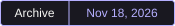
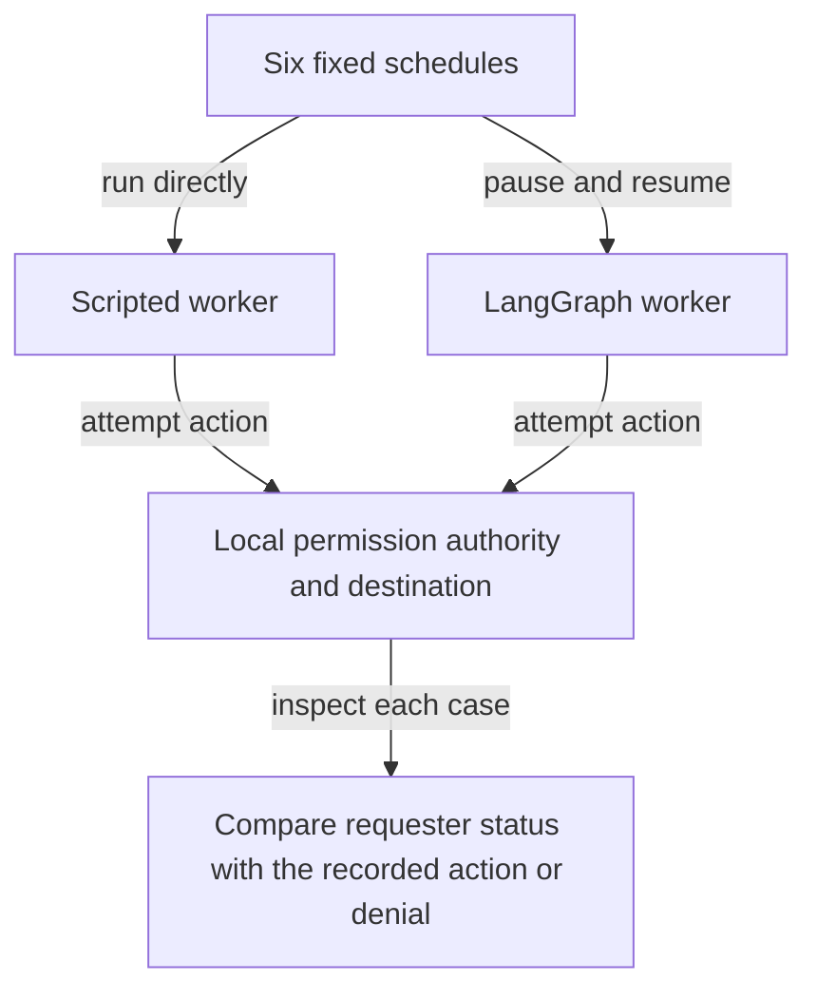

> **Research status · November 24, 2026 · Local study closed**
>
> **Held:** In 12 scripted cases, the saved records show whether permission ended and whether the action took effect. A requester who received no reply saw the same status in two scenarios with opposite outcomes.
>
> **Open:** Independent replication, behavior with live AI agents and reliability in deployed systems.

<h1 id="revocation-in-delegated-workflows">
<a href="https://nodeandnorm.org/">
<picture>
  <source media="(max-width: 600px)" srcset="https://raw.githubusercontent.com/node-and-norm/.github/13bac647d54ab62f3e6a8b500b2e5edc03e5227e/assets/research/v2/revocation-delegated-workflows/banner-mobile.svg">
  
</picture>
</a>
</h1>

[](https://nodeandnorm.org/research/#current-study) [](docs/review/WITHDRAWAL_INTERFACE_SUMMARY_v0.1.json) [](https://github.com/node-and-norm/revocation-delegated-workflows/releases/tag/research-archive-2026-11-18)

When someone withdraws permission for work already underway, what can they tell the person waiting for the outcome? This study follows a request to stop from the requester to the system where the action takes effect. [Read Essay 01, *You asked it to stop. Did it?*](https://nodeandnorm.org/research/revocation/essay/)

[Policy reader · Understand the finding](#research-in-90-seconds) · [Reviewer · Inspect the evidence](#evidence-and-known-limits) · [Engineer · Reproduce the checks](#reproduce-the-checks)

## At a glance

| | Current account |
| :--- | :--- |
| Purpose | Determine what a requester can know about an action after asking for it to stop. [Study design](docs/review/WITHDRAWAL_INTERFACE_DESIGN_v0.1.md) |
| Status | The November 24, 2026 closeout reviewed the saved evidence. [Public study overview](https://nodeandnorm.org/research/#current-study) |
| Evidence type | Six fixed schedules, each run directly and through a LangGraph workflow that could pause and resume. [Case records](docs/review/WITHDRAWAL_INTERFACE_SUMMARY_v0.1.json) |
| Version | Experimental software archive, November 18, 2026. [Tagged pre-release](https://github.com/node-and-norm/revocation-delegated-workflows/releases/tag/research-archive-2026-11-18) |
| License | The public repository carries no open-source license grant for the original study materials. Bundled third-party materials retain their own notices. |
| Cite | Cite the [software archive](CITATION.cff) for the code and the [November 24 essay](https://nodeandnorm.org/research/revocation/essay/) for the published account. |

## Research in 90 seconds

A requester sent a stop request and waited. No reply came. In one scenario, the request arrived, permission ended and the system blocked the worker’s next action. In the other, the request never reached the authority during observation. The worker went ahead. The requester saw silence both times. A reviewer could tell the outcomes apart by checking whether permission had changed and whether the destination had recorded an action.

### What the requester could know

| Schedule | What the requester saw | What the authority and destination recorded |
| :--- | :--- | :--- |
| S4 · Reply withheld | No confirmation arrived. | Permission ended before the worker tried to act. The attempt was denied. |
| S5 · Request withheld | No confirmation arrived. | Permission stayed active during observation. One action went through. |
| S2 · Action first | Confirmation arrived that permission had ended. | The action had already taken effect. It remained in the record. |

For a reviewer, S2 poses a further question. A confirmation can establish that permission ended. To tell someone that the intervention stopped a particular action, the reviewer also needs to know whether that action had already happened. [Inspect the S4 and S5 records](notebooks/learning_02a_exact_s4_s5_records.ipynb) · [See all six schedules](docs/decisions/2026-11-03-request-to-fence-interface-study.md)

## Method in brief

The test set the order of events in advance. Each schedule ran on two paths with the same local permission rules and destination. The checker compared what the requester could see with what the destination recorded.



The permission and destination records shared one trusted SQLite database. Each case used one handoff and at most one outstanding withdrawal. [Study protocol](docs/review/WITHDRAWAL_INTERFACE_PROTOCOL_v0.1.md) · [Post-run review](docs/review/WITHDRAWAL_INTERFACE_POSTRUN_REVIEW_v0.1.md)

## Evidence and known limits

| Evidence | What the records support | What remains open |
| :--- | :--- | :--- |
| [12 workflow cases](docs/review/WITHDRAWAL_INTERFACE_SUMMARY_v0.1.json) | Six actions went through while permission was active. Six attempts were denied after it ended. Each pair of paths produced the same outcome under its assigned schedule. | How often these outcomes occur in production, and how independent services or live AI agents behave. |
| [Local reproduction](docs/review/WITHDRAWAL_INTERFACE_LOCAL_REPRODUCTION_v0.1.md) | A fresh environment on the same host reproduced the outcomes with the frozen instrument. | Independent replication with a separate implementation or operating environment. |
| [Requester observations](notebooks/01_revocation_evidence_workbench.ipynb) | The saved records distinguish what the requester could know from what a reviewer with access to the destination could establish. | Whether giving people this evidence improves review or decisions in practice. |

### Preserved v0.2 qualification

An earlier phase used 18 configured cases to test the measurement rules. Review found three checker errors. The record preserves the counterexamples and corrections. A separate integration pilot used eight fixed cases. Each stage has its own protocol and results. [Qualification record](qualification/v0.2/README.md) · [Integration pilot](integration/v0.3/README.md)

## Reproduce the checks

### Inspect or reproduce the evidence

Start with the [guided study notebook](RESEARCH_STUDY.ipynb) or [research-book contents](notebooks/00_start_here.ipynb). The [methods notebook](notebooks/03_methods_and_reproduction.ipynb) and [recorded inputs and outputs](notebooks/04_exact_scripted_inputs_outputs.ipynb) lead to individual cases.

### Reproduce the request-to-fence study

Extract the [study archive](archives/withdrawal_interface_study_v01_20261103.zip). From the study directory containing `measured01/` and `frozen_candidate_v02/`, this command checks the saved records against the destination databases using Python’s standard library.

```sh
python3 frozen_candidate_v02/independent_checker.py measured01/direct/S*/record.json measured01/framework/S*/record.json
```

The [reproduction instructions](docs/review/WITHDRAWAL_INTERFACE_REPRODUCTION_v0.1.md) also cover running the workflows again in a compatible environment. The [local reproduction report](docs/review/WITHDRAWAL_INTERFACE_LOCAL_REPRODUCTION_v0.1.md) records the dependencies and the comparison with the originals.

## AI assistance and research responsibility

Mark Julius Banasihan is responsible for the research decisions. AI tools assisted with design, implementation, checking, separately assigned reviews and writing. The study workbook identifies recorded human decisions and the checks performed. Independent human validation remains open. [Study disclosure notebook](notebooks/02_traceability_and_disclosure.ipynb) · [Node & Norm research integrity](https://nodeandnorm.org/about/research-integrity/#ai-use)

## Release and citation

The November 18 release notes describe the repository when it was private. The repository is now public. The [November 24 closeout](https://nodeandnorm.org/research/#current-study) examined the existing evidence. To cite the archived code, use **Cite this repository** or the [citation file](CITATION.cff).

> Banasihan, Mark Julius (2026). *Revocation in delegated workflows*. Experimental research archive, November 18, 2026. [GitHub pre-release](https://github.com/node-and-norm/revocation-delegated-workflows/releases/tag/research-archive-2026-11-18) · [Exact source revision](https://github.com/node-and-norm/revocation-delegated-workflows/tree/2ec55580a864d55c261de5770f2c58e58e828332)

<details>
<summary>Study history and earlier reading guide</summary>

The [dated study synthesis](docs/reports/2026-11-06-current-study-synthesis.md) and the [November 18 reading guide](https://github.com/node-and-norm/revocation-delegated-workflows/blob/032575d799cf2efb819508813f35bc9ffa2556a0/README.md) preserve the earlier stages and technical notes.

</details>
