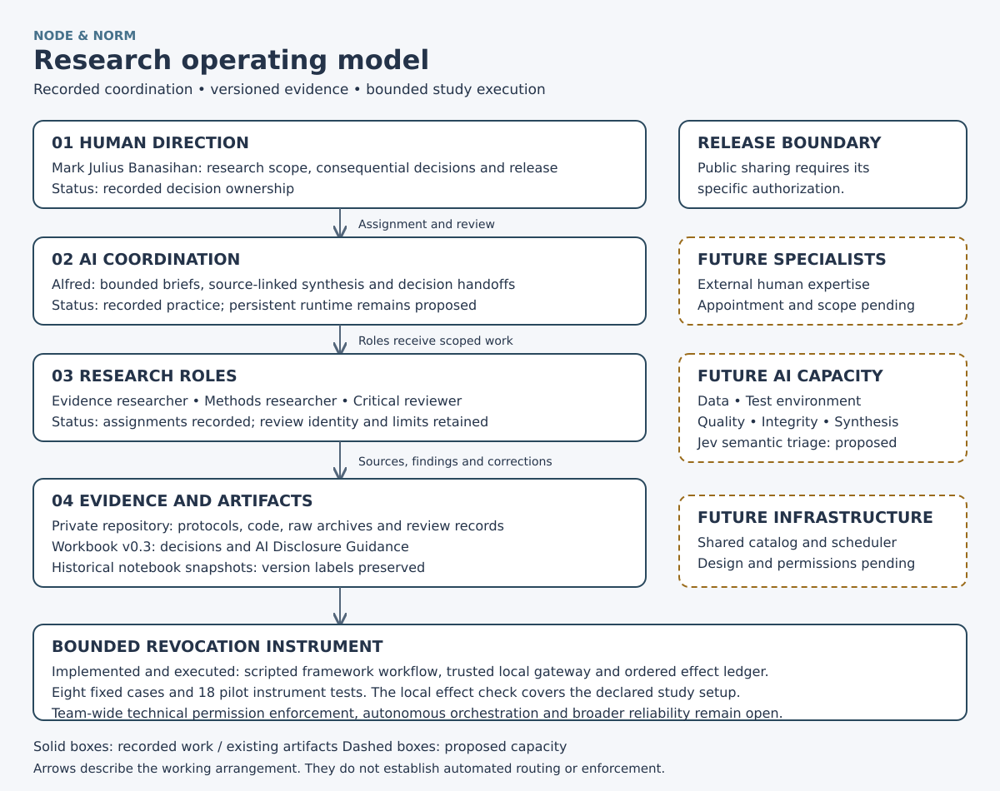

# Node & Norm: Technical Spec of the Research Operating Stack

Version 0.3 · 3 November 2026 · Draft for Mark Julius Banasihan's review

**Contents:** [System overview](#system-overview) · [Human layer](#human-layer-research-lead-and-specialist-bench) · [Agent layer](#agent-layer-capabilities-and-permissions) · [Data](#data-sources-and-maintained-artifacts) · [Workflows](#core-workflows) · [Controls](#control-model-and-observed-failure-modes) · [Operator modes](#operator-modes) · [Performance](#reported-performance) · [Implementation](#reference-implementation-current-components-and-proposed-extensions) · [AI disclosure](#ai-disclosure-and-research-integrity) · [Open questions](#undisclosed-elements-and-open-questions) · [Sources](#sources)

## Purpose and evidence standard

Research continuity depends on knowing which question is active, where its evidence lives, and what the team has permission to do next.  This specification brings those elements together for Node & Norm's AI-assisted research team.  It adapts the structure of the supplied *Pipeline-in-a-Person: Technical Spec of Mithril's Operating Stack* to the current revocation study and a proposed multi-study program.

The supplied document combines reported practices, founder statements, and a reconstructed design.  Its architecture serves as a reference for organizing this specification.  Node & Norm's status and results below come from its own records.  The attachment's biomedical claims, staffing, performance figures, and reconstructed product choices have not been adopted as Node & Norm findings.

| Status | Meaning | Evidence required |
| --- | --- | --- |
| Recorded | A source, artifact, completed activity, or user decision appears in the research record | Exact locator and scope |
| Implemented | Code or a configuration exists for a stated function | Inspectable artifact and version |
| Executed | A specified run produced preserved outputs | Protocol, inputs, environment and output records |
| Proposed | A design or future capability awaits a decision or execution | Rationale, alternatives, open questions and authorization boundary |
| Unresolved | Available evidence leaves the claim open | Missing evidence or competing explanations |

A status applies to the named component or claim.  The existence of a workflow document establishes documentation; a working automated workflow requires separate implementation and execution evidence.

## System overview

The working arrangement connects human direction, AI coordination, specialist assignments and preserved research evidence. Mark Julius Banasihan owns consequential research and release decisions. Alfred coordinates bounded assignments and returns findings for review. The diagram shows those responsibilities and the separate status of the executed research instrument.

**Read the diagram:** solid boxes describe recorded work or existing artifacts. Dashed boxes identify proposed capacity. Arrows show the intended flow of assignments, evidence and review. They describe a working arrangement; technical enforcement is established only for the bounded local effect check in the study instrument.

| Layer | What exists | Current status | Evidence locator |
| --- | --- | --- | --- |
| Human direction | Research scope and consequential decisions owned by Mark Julius Banasihan | Recorded | [Charter](CHARTER.md), [decision records](../decisions/) |
| Coordination | Alfred prepares assignments, integrates findings and surfaces decisions | Recorded practice | [Assignment workflow](WORKFLOW.md) |
| Research roles | Evidence, methods and critical-review assignments | Recorded assignments; repeatable workflow documented | [Role responsibilities](CHARTER.md#responsibilities-and-review) |
| Evidence and execution | Versioned repository, workbook, protocols, code, raw archives and review records | Implemented; bounded pilot executed | [Repository guide](../../README.md), [pilot archive](../../archives/revocation_integration_pilot_v03_20261103.zip) |
| Future capacity | Dedicated specialists, shared catalog and automated research runtime | Proposed | [Decision queue](CHARTER.md#long-term-roles-and-decision-record) |

The repository provides continuity through durable records. A persistent scheduler, automatic task queue and cross-study discovery engine remain unimplemented. Public release has a separate authorization boundary.

## Human layer: research lead and specialist bench

| Role | Staffing status | Responsibilities | Decision rights | Evidence |
| --- | --- | --- | --- | --- |
| Research lead: Mark Julius Banasihan | One named human research lead | Selects direction, reviews claims and decides next steps | Scope, consequential actions and release | Recorded |
| External domain or methods reviewer | Proposed; no appointment recorded | Supplies expertise under a defined brief | Advisory scope to be agreed | Proposed |
| Participant or independent reviewer panel | Proposed; no recruitment recorded | Applies an approved evaluation protocol | Protocol-defined judgments | Proposed |

The [charter](CHARTER.md) defines AI-assisted evidence, methods, and critical-review responsibilities.  Future data, test-environment, quality, integrity, and cross-study synthesis roles remain planning entries.  Assignments will identify the contributors actually used and the work they performed.  Independent human validation requires a documented human review process.

## Agent layer: capabilities and permissions

| Function | Current position | Boundary |
| --- | --- | --- |
| Read research material | Recorded within authorized sources | Verify source access, provenance, privacy and reuse conditions |
| Analyze sources and propose methods | Recorded | Separate source claims, interpretation and proposed action |
| Prepare local documents and code | Available within a bounded approved assignment | Preserve historical artifacts and record material AI assistance |
| Run study code | Existing bounded runs are preserved | New experiments require the applicable execution approval |
| Update the private repository | Authorized for requested documentation | Keep the change within the requested scope and verify committed artifacts |
| Use Jev for structured semantic judgments | Proposed for this study | Prior live TAE × Jev work is separate; new calls, credentials and costs require approval |
| Contact others or publish | Separate decision | Recipient, information, purpose and consequential content need applicable authorization |
| Schedule persistent automation | Proposed | Requires a defined task, permissions, resource limits, stop behavior and validation |

These rows describe the working arrangement.  Technical permissions vary by tool and task.  A written rule should not be treated as proof that a runtime enforces it.

## Data sources and maintained artifacts

| Input or artifact | Use | Current evidence boundary |
| --- | --- | --- |
| v0.3 protocol, code and raw archive | Examine the executed delegated workflow and reproduce its declared checks | Synthetic, scripted workers and a trusted local gateway |
| Qualification archives | Preserve earlier instruments, failures, corrections and negative controls | Finite qualification checks under their original criteria |
| Primary papers, documentation and repositories | Identify prior work and supported capabilities | Source inspection is distinct from runtime validation |
| Governance Explorer | Discover research questions and possible connections | Selected risks/incidents and AI-assisted editorial relevance mappings |
| Decision records, workbook and notebook | Track claims, assistance, corrections and decisions | Versioned snapshots; synchronization requires an explicit check |
| Team charter and workflow | Define roles, review responsibilities and handoffs | Documented operating guidance |
| Future evidence catalog and connection register | Link related sources and testable hypotheses across studies | Proposed; no central validated dataset is claimed |

The [Governance Explorer](https://nodeandnorm.org/governance-map) data reviewed on 3 November contains eight programs, 80 topics and 640 editorial relevance assessments, plus 130 selected risks and 56 incident cases.  A mapped association suggests where to investigate.  Causation, control effectiveness, legal applicability and compliance require their own evidence.  Source-level licenses and redistribution conditions need verification before reuse.

## Core workflows

Each workflow begins with a bounded question, named inputs, a permitted action and an expected deliverable. The assignment record identifies which steps actually occurred.

### W1. Research handover

**Status: recorded practice; repeatable automation proposed.**

1. Alfred identifies the active question, latest decision, canonical artifacts and unresolved concerns.
2. The assignment names the source versions, permitted actions and receiving role.
3. The receiving role checks for missing context and identifies constraints on its conclusion.
4. Alfred integrates the findings into a decision brief with evidence links and the next decision needed.

### W2. Evidence package review

**Status: packet preparation and artifact qualification complete; reviewer evaluation remains proposed and unperformed.**

The [qualification record](../decisions/2026-11-03-retrospective-packet-qualification.md) preserves the frozen specification, eight derivative packets, extraction code and corrections from two historical pilot cases. The complete administrator archive contains answer material; each blinded reviewer would receive only an assigned packet. Repository access itself provides no file-level separation.

1. The preserved specification defines the review question and scoring rubric before packet construction.
2. Packet preparation and qualification checked source fidelity, neutral labels and case-map handling. Future administration must maintain separation between reviewer packets and administrator materials.
3. Reviewers would assess the resumed attempt, earlier effects, ordering, provenance and missing evidence.
4. Scoring would assess both agreement with the ledger and what the supplied packet justified. A lucky unsupported guess receives no evidence-quality credit.
5. Qualification records retain leakage checks and corrections. Reviewer administration and evaluation require their applicable approval; no reviewer-performance result exists.

### W3. Decision propagation

**Status: manual documentation updates recorded; automatic propagation proposed.**

1. Record the human decision, rationale, scope and effective version.
2. List dependent artifacts: protocol, code, expected results, claim register, workbook, notebook and external draft.
3. Propose the specific edits and identify historical snapshots to preserve.
4. Apply authorized edits, check the resulting versions and record synchronization status.
5. Surface unresolved dependencies and consequential changes for review.

### W4. New study scoping and connection review

**Status: proposed program workflow.**

1. Create a question record from a source or Governance Explorer connection.
2. Verify underlying material, reuse rights and closest prior work.
3. Specify a small useful test, competent baseline and evidence that would reject the proposal.
4. Review competing explanations, resource requirements and the value of the prospective contribution.
5. Mark Julius Banasihan decides whether to continue. The execution-grounded revocation question remains active.

### W5. Claim preparation with a provenance ledger

**Status: proposed common template.**

1. List consequential claims and synthesized figures.
2. Record each source locator and version, derivation, uncertainty, review performed and next evidence needed.
3. Classify origin as instructed, extracted, calculated, inferred or unresolved.
4. Check extracted values against their source and calculations against their inputs.
5. Propagate material corrections to each dependent claim and preserve the correction history.

## Control model and observed failure modes

| Control or check | Present evidence | Failure addressed | Remaining limitation |
| --- | --- | --- | --- |
| Versioned artifacts and hashes | Implemented; manifests verified after repository updates | Undetected byte changes and unclear artifact versions | Hashes alone leave truth and source authenticity unresolved |
| Local effect-boundary authority check | Implemented and executed in the bounded pilot | A new protected local effect after the declared withdrawal boundary | Trusted gateway, one host, scripted workers and limited schedules |
| Separate AI-assisted review | Recorded | Instrument errors and unsupported interpretations | Shared models and assumptions can limit independence |
| Fixed transcript and binding checks | Implemented in the pilot checker | Wrong denial cause or inconsistent event bindings | Complete-transcript checker needs redesign for limited-evidence review |
| Evidence-entitlement rubric | Documented in the qualified packet specification | Confident conclusions from insufficient review packets | No reviewer-performance result exists yet |
| Source-linked claim ledger | Proposed common template | Silent assumptions and untraceable extracted figures | Coverage and review quality need evaluation |
| Human release decision | Required by current working arrangement | Unapproved public claims or disclosure | Technical enforcement requires a separate runtime design |

The recorded pilot corrections show why endpoint checks need supporting evidence: an absent effect can result from invalid preparation or another denial cause.  The review record preserves those errors and corrections.  The proposed reconstruction exercise adds a related distinction between a denied resumed attempt and an operation's earlier effects.

## Operator modes

These modes describe assignment boundaries. They have no implemented mode selector or automatic access-control switch.

| Mode | Operator intent | Permitted work under the assignment | Required output | Status |
| --- | --- | --- | --- | --- |
| Explore | Understand a question and closest prior work | Read authorized sources, compare claims and identify missing evidence | Source-linked options and rejection criteria | Recorded practice |
| Design | Specify a bounded useful test | Draft protocol, controls, rubric and resource requirements | Reviewable design with open decisions | Recorded practice |
| Execute | Run an explicitly approved protocol | Use the named setup and inputs within the approved scope | Versioned raw outputs, failures and environment record | Existing pilot executed; future runs require their own decision |
| Review | Challenge methods, evidence and interpretation | Inspect records and check claims within the approved review scope | Findings, corrections, unresolved issues and review identity | Separate AI-assisted review recorded |
| Maintain | Preserve authorized research artifacts | Update named private documents and verify versions/checksums | Change record and synchronization status | Current documentation mode |
| Release | Share approved research with a defined audience | Only the specific approved publication or communication | Reviewed claims, disclosures, rights and provenance | Public release remains pending |

A change from reading or design to execution, external sharing or persistent access requires the applicable permission. An operator request identifies intent; each consequential action still needs the appropriate scope and approval.

## Reported performance

| Measure | Recorded result or status | Interpretation |
| --- | --- | --- |
| v0.3 declared cases | Eight fixed cases matched expected results | Bounded integration conformance |
| v0.3 instrument tests | 18 passed in the recorded qualification | Engineering checks of this instrument |
| v0.3 revoked attempts | Four denied; no post-fence effects recorded | Applies to the declared test configuration and observations |
| v0.3 live controls | Four produced their expected new-effect or duplicate disposition | Supports the matched authorized paths |
| Request-to-fence collection | 12 fixed cases: six effects and six revoked denials; no post-fence effects recorded | [Separate bounded interface study](../decisions/2026-11-03-request-to-fence-interface-study.md); counts remain separate from v0.3 |
| Same-host reproduction | 12 fresh cases matched the unchanged frozen checker | [Fresh virtual environment on the same host](../review/WITHDRAWAL_INTERFACE_LOCAL_REPRODUCTION_v0.1.md); same instrument, no independent implementation |
| Protocol-first artifact audit | 12 saved cases passed; 20 artifact mutants rejected | [Separately authored AI-assisted checker](../review/WITHDRAWAL_INTERFACE_PROTOCOL_FIRST_AUDIT_v0.1.md); no new collection or human validation |
| Team throughput, cost and review time | Unmeasured | No productivity gain or staffing multiplier established |
| Reviewer reconstruction and abstention | Proposed measures | Requires a fixed rubric and authorized evaluation |
| Jev calibration and incremental benefit | Unestablished for this study | Requires a task-specific comparison |

Fixed cases and repeated checks carry dependence.  Report their actual unit of analysis and avoid population reliability claims.  Future measures should include unsupported conclusions, correct uncertainty, source-verification errors, correction burden, review time and resource use.  Prespecify definitions and denominators before collection.

## Reference implementation: current components and proposed extensions

The reference below separates existing study components from proposed team infrastructure. The implemented local gateway belongs to the revocation instrument. It does not enforce the permissions of the entire research team.

| Layer | Requirement | Current component or build choice | Configuration and validation status |
| --- | --- | --- | --- |
| Plan of record | Recover the active question, limits and decisions | Private repository README, protocol, charter and workflow | Existing documentation; versioned in Git |
| Evidence store | Retain source and run provenance | Study archives, JSON summaries, SQLite evidence and SHA-256 manifest | Existing artifacts; integrity checks establish byte consistency |
| Compute | Reproduce declared bounded cases | [Pilot package](../../archives/revocation_integration_pilot_v03_20261103.zip) and [setup instructions](../../integration/v0.3/README.md) | Executed synthetic configuration; scripted model responses |
| Effect control | Check current authority at protected commit | Trusted local gateway with shared SQLite ordering | Tested under declared assumptions; one authority root and parent–child edge |
| Assignment routing | Give each role scope, inputs and a handoff | Coordinator-led assignments and [workflow](WORKFLOW.md) | Recorded manual coordination; automated routing proposed |
| Research continuity | Preserve decisions and AI contributions | [Workbook v0.8](../traceability/Revocation_AI_Use_and_Research_Decision_Traceability_v0.8.xlsx) and historical notebook snapshots | Existing records; explicit synchronization needed |
| Semantic triage | Assess support, conflict or missing evidence | Proposed TypeSafe AI Jev comparison | No new study integration or evaluation established |
| Multi-study catalog | Link reusable sources without erasing context | Proposed study/source/claim/decision IDs and connection register | Schema, rights and update process await review |
| Persistent runtime | Schedule, isolate, stop and recover bounded work | Hosting, identity, credentials and scheduler undecided | Proposed; implementation requires separate authorization |

### Build order

The current repository supplies a foundation for a reusable operating system for research.  Further implementation should proceed through explicit decisions:

1. Stabilize the charter, handoff format, claim ledger and decision register.
2. Use the completed reconstruction packet specification and qualification record as the starting point for an evaluation decision, preserving raw evidence.
3. Review the protocol, baseline, leakage risks and permission requirements.
4. Conduct a bounded evaluation only after approval, recording failures and corrections.
5. Evaluate shared catalog and cross-study synthesis needs using verified source inventories and rights.
6. Consider runtime automation after repeated manual assignments establish useful inputs, checks and stopping conditions.

A future runtime could load approved assignments, route tasks by role, preserve provenance, surface decisions and stop at permission boundaries.  Its architecture, hosting, credentials, costs and failure recovery remain open.  The current documents specify a working arrangement and future design choices. An orchestration product requires separate implementation and validation.

## Jev's proposed place in the stack

Jev could support semantic evidence triage after deterministic source, identity, digest, ordering and authorization checks.  Candidate judgments include source support, contradiction, ambiguity and missing evidence.  The [charter's Jev plan](CHARTER.md#planned-use-of-typesafe-ais-jev) requires equal-evidence baselines, pinned versions, preserved raw/rejected outputs and separate reporting of errors, calibration, abstention coverage, cost and latency.

Earlier TAE × Jev work includes live calls and remains relevant experience.  Its findings retain their original scope.  Mark Julius Banasihan retains decision authority, and an unresolved or refer-for-review path remains available.  No Jev call or new model experiment was performed for this specification.

## AI disclosure and research integrity

The [workbook v0.8](../traceability/Revocation_AI_Use_and_Research_Decision_Traceability_v0.8.xlsx) includes **AI Disclosure Guidance**, the original publisher-policy references, their recorded access dates and qualifications. Those references are a retained guidance snapshot. This revision performs no fresh policy verification. The applicable publisher, conference, funder or institutional requirements must be checked against current official sources before submission.

| Disclosure element | Research record to preserve | Review action before release |
| --- | --- | --- |
| Tools and versions | Tool/model identity and version when available, dates, task and material contribution | Identify unavailable version information explicitly |
| Contribution | Framing, source analysis, code, tests, review, synthesis and writing actually assisted by AI | Match the statement to the submitted artifacts |
| Human responsibility | Named decision owner and the review actually performed | Mark Julius Banasihan confirms the account; avoid implying unperformed human validation |
| Evidence and corrections | Source locators, calculations, rejected outputs, errors, corrections and affected claims | Verify consequential claims and citations against retained evidence |
| Reproducibility | Protocol, inputs, environment, code version, outputs and applicable permissions | Provide the permitted artifacts and explain access limits |
| Rights and confidentiality | Source licenses, private records, consent and authorized recipients | Check disclosure and redistribution before release |
| Venue-specific requirements | Current official policy, version/access date, required wording and placement | Record which requirements apply and unresolved questions |

Publisher policies, voluntary standards, organizational practice and legal obligations have distinct scopes. The workbook does not establish a universal industry standard or certify compliance. AI-assisted review is disclosed separately from independent human review. Constrained output formats and completed checklists leave factual verification as a separate responsibility.

**Synchronization:** workbook v0.8 is the current committed traceability snapshot. It records packet qualification, the request-to-fence collection, local reproduction, protocol-first audit and prior-art comparison, alongside earlier team and disclosure decisions. The v0.2 JSON, tables and notebook retain their historical capture state. This presentation revision updates status and navigation only. It leaves workbook v0.8 unchanged and does not imply that snapshot already records this later correction.

The coordinator should reconcile material decisions across the repository, workbook and notebook, retaining exact versions and synchronization status. Record AI assistance, source evidence, human decisions, review performed and corrections for each material assignment.

## Undisclosed elements and open questions

Use the [long-term decision record](CHARTER.md#long-term-roles-and-decision-record) and [workflow](WORKFLOW.md#maintain-the-long-term-decision-record) to preserve options, evidence, rationale, owner and revisit trigger.

- [ ] Which approved question would benefit from a first reconstruction evaluation?
- [ ] What constitutes a competent baseline under the same evidence and review budget?
- [ ] How will packet custody and answer leakage be controlled?
- [ ] Which source licenses permit a shared evidence catalog?
- [ ] When does specialist separation improve review quality enough to justify its cost?
- [ ] Which claims warrant external human review before release?
- [ ] What concrete repeated task would justify an automated runtime?
- [ ] Which evidence would show that Jev adds value beyond simpler methods?

## Sources

| Source class | Use in this specification | Verification boundary |
| --- | --- | --- |
| Node & Norm repository artifacts | Implementation, execution, corrections and scope | Linked records support bounded claims |
| User-supplied Mithril specification | Section sequence, tables and layered presentation | The supplied Markdown exposes an embedded-diagram placeholder; this diagram is an original Node & Norm adaptation |
| AI Disclosure Guidance workbook | Retained policy references and research-disclosure practice | Original access dates apply; current venue requirements await review |
| Governance Explorer | Source discovery and possible connections | Editorial relevance and selected source coverage |

- User-supplied *Pipeline-in-a-Person: Technical Spec of Mithril's Operating Stack*, dated 3 November 2026: structural reference for the layers, workflows, controls, measures and open decisions used here.  Its reported external claims have not been independently revalidated in this adaptation.
- [Current pilot protocol](../../integration/v0.3/PROTOCOL.md), [results](../../integration/v0.3/RESULTS.json), [separate AI-assisted review](../../integration/v0.3/evidence/reviewer_final.json), and [full evidence archive](../../archives/revocation_integration_pilot_v03_20261103.zip): Node & Norm's recorded implementation and execution evidence.
- [Pilot decision](../decisions/2026-11-03-bounded-integration-pilot.md), [team charter](CHARTER.md), and [assignment workflow](WORKFLOW.md): scope, responsibilities and proposed next work.

Revision 0.3 corrects current packet status, surfaces the separate request-to-fence collection and review records, and updates navigation to workbook v0.8. Historical study artifacts remain unchanged.

Revision 0.2 aligned the section structure and tables with the supplied reference, added the system diagram and operator modes, expanded the reference implementation, and linked the then-current disclosure workbook. AI assisted both revisions and their artifact checks. Mark Julius Banasihan's review remains pending.

This adaptation adds documentation only.  Existing experimental artifacts, implementation status, permissions and release limits remain in force.
